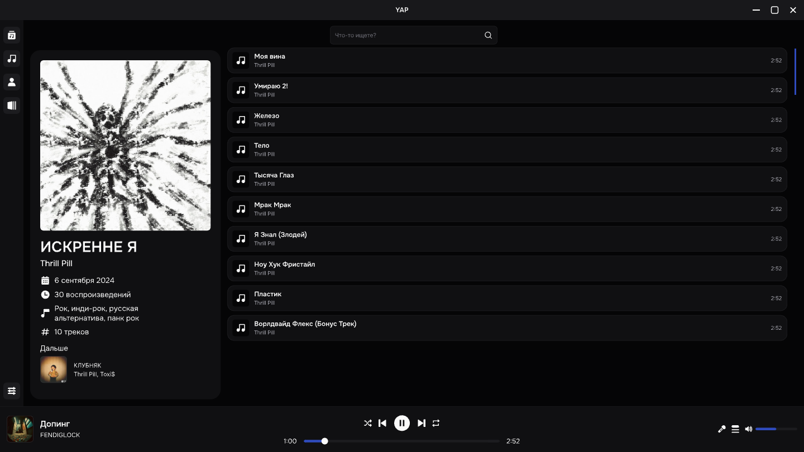

# YAP · Yet Another Player

YAP — плеер для музыки, которая хранится у тебя на компьютере. Выбери папку с треками, и YAP соберёт из них медиатеку с альбомами, исполнителями и обложками. Можно слушать музыку офлайн, собирать плейлисты и читать синхронизированные тексты, когда они доступны.

[Скачать YAP из GitHub Releases](https://github.com/BADtochka/yet-another-player/releases/latest)

## Первый запуск

Нажми **«Выбрать папку»** и укажи, где лежит твоя музыка. YAP просканирует файлы и откроет медиатеку. Другие папки можно добавить позже в настройках.

## Как выглядит медиатека

На макете из Pixso открыт альбом с обложкой, списком треков и плеером внизу. В YAP можно искать по своей коллекции и переключаться между списком и сеткой.

Для поиска и загрузки музыки из внешних источников установи **yt-dlp** в разделе **Настройки → Внешние инструменты**. Нажатие на карточку скачивает лучший доступный аудиоформат, который поддерживает плеер, и запускает воспроизведение.

### Обогащение метаданных

Открой **Настройки → Внешние инструменты → OMMR**. YAP может установить и запустить локальный [Open Music Metadata Resolver](https://github.com/Wilooper/OpenMusicMetadataResolver-OMMR) или подключиться к уже работающему серверу. В настройках OMMR можно выбрать источники и проверить подключение. После следующего сканирования YAP дополнит медиатеку в фоне. Для установки локального сервера нужен доступ к GitHub, go.dev и proxy.golang.org.

## Установка

| Система | Как установить |
| --- | --- |
| Windows x64 | Запусти установщик `*-setup.exe`. |
| macOS · Apple Silicon и Intel | Открой `.dmg` и перетащи YAP в папку «Программы». Если macOS заблокирует первый запуск, открой **Системные настройки → Конфиденциальность и безопасность → Всё равно открыть**. |
| Debian / Ubuntu x86_64 | Установи `.deb` командой `sudo apt install ./имя-пакета.deb`. |
| Arch Linux x86_64 | Установи `.pkg.tar.zst` командой `sudo pacman -U ./имя-пакета.pkg.tar.zst`. |
| Другие дистрибутивы Linux x86_64 | Сделай `.AppImage` исполняемым и запусти его. |

Если в последнем релизе пока нет установщика для твоей системы, проверь артефакты тестовых сборок. [GitHub Actions](https://github.com/BADtochka/yet-another-player/actions/workflows/windows-build.yml)

В релизной сборке можно проверить обновления в настройках. На Arch YAP проверит подпись скачанного пакета и покажет команду для установки через `pacman`.

## Участие в проекте

Как запустить YAP из исходников, проверить изменения и собрать установщик, описано в [CONTRIBUTING.md](CONTRIBUTING.md). Код доступен по [лицензии MIT](LICENSE).
